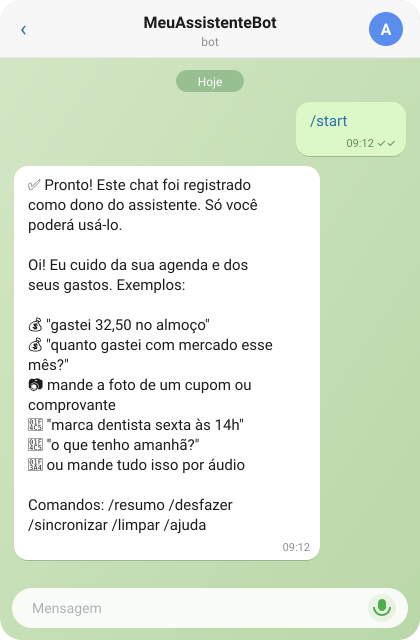
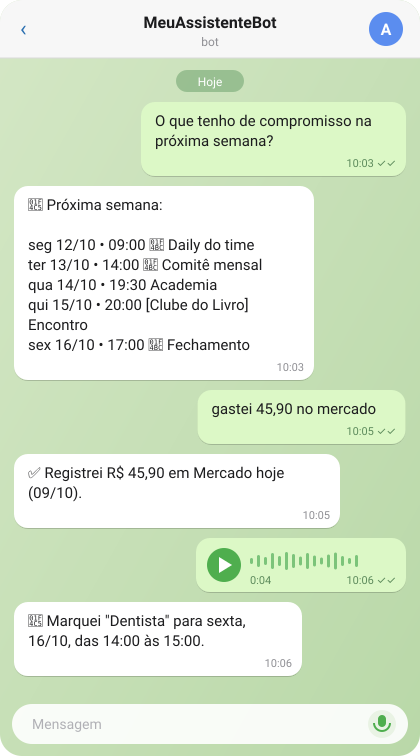
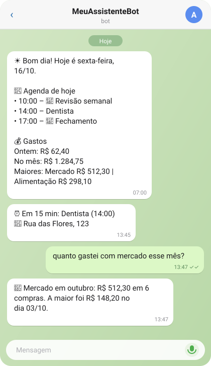

# Assistente Pessoal no Telegram

Bot pessoal no Telegram que cuida da **agenda** e dos **gastos** por mensagem de texto, áudio ou foto, usando IA. Roda 100% de graça no Google Apps Script — sem servidor.

```
Você (Telegram)  ──►  Google Apps Script  ──►  Gemini (IA)
   texto / 🎤 / 📷          │
                            ├──►  Google Agenda   (pessoal + extras + trabalho)
                            ├──►  Google Planilhas (gastos)
                            └──◄  Outlook (link ICS, somente leitura)
```

## Veja funcionando

<p align="center">
  
  &nbsp;
  
  &nbsp;
  
</p>

<p align="center"><sub>Ilustrações com dados fictícios.</sub></p>

## O que ele faz

| Você manda | O bot faz |
|---|---|
| "gastei 32,50 no almoço" | Lança o gasto na planilha (categoria Alimentação) |
| 📷 foto de cupom ou comprovante | Lê valor, local e data e registra |
| "quanto gastei com mercado em setembro?" | Soma e detalha os gastos |
| 🎤 "marca dentista sexta às 14h" | Cria o compromisso no Google Agenda |
| "o que tenho amanhã?" | Lista os compromissos de todas as agendas |
| "muda a reunião de amanhã para 16h" | Altera o evento (só da agenda pessoal) |

E também, sozinho:

- **☀️ Resumo diário às 7h** com a agenda do dia e os gastos de ontem e do mês.
- **⏰ Lembretes** antes de cada compromisso (padrão: 15 min antes).
- **💼 Sincroniza o Outlook do trabalho** com o Google Agenda a cada 15 min: o que for criado, alterado ou removido no Outlook é refletido no Google.

### Comandos

| Comando | Função |
|---|---|
| `/resumo` | Resumo do dia na hora |
| `/desfazer` | Apaga o último gasto registrado |
| `/sincronizar` | Atualiza a agenda do Outlook agora |
| `/limpar` | Zera a memória da conversa |
| `/ajuda` | Mostra os exemplos |

## Tecnologias (tudo gratuito)

| Peça | Serviço |
|---|---|
| Conversa | Bot do Telegram |
| "Servidor" | Google Apps Script (App da Web + gatilhos de tempo) |
| IA | Google Gemini API, camada gratuita (`gemini-3.1-flash-lite`, com modelos reserva) |
| Agenda | Google Agenda (`CalendarApp`) |
| Gastos | Google Planilhas (`SpreadsheetApp`) |
| Agenda do trabalho | Link ICS publicado pelo Outlook / Microsoft 365 |

## Estrutura do repositório

```
src/
  Codigo.gs          código completo do bot (cole no Apps Script)
  appsscript.json    manifesto do projeto (fuso, runtime V8, App da Web)
docs/
  instalacao.md            passo a passo do zero
  outlook.md               sincronização com o Outlook do trabalho
  configuracoes.md         o que dá para ajustar no topo do código
  solucao-de-problemas.md  erros que já aconteceram e como resolver
```

## Começando

Siga o **[guia de instalação](docs/instalacao.md)** (uns 30 minutos). Depois, se quiser a agenda do trabalho, veja **[Outlook](docs/outlook.md)**.

## Segurança e privacidade

- **Nunca coloque o token do Telegram, a chave do Gemini ou o link ICS em um commit.** No repositório o código vai com os valores `COLE_AQUI_...`. Depois de rodar `configurar`, os segredos ficam guardados nas *Propriedades do script*, fora do código.
- Só o primeiro chat que manda `/start` vira **dono** do bot; mensagens de qualquer outra pessoa são ignoradas.
- O webhook usa um token secreto na URL, gerado automaticamente.
- No plano gratuito do Gemini, o Google pode usar o conteúdo das mensagens para melhorar os modelos. Evite mandar dados sensíveis e confira a política da sua empresa antes de sincronizar a agenda do trabalho.
- Quem tiver o link ICS do Outlook consegue ver a sua agenda. Trate-o como senha.

## Limitações conhecidas

- As cotas gratuitas do Gemini e do Apps Script mudam com o tempo. Para uso pessoal, sobram.
- A atualização do Outlook não é instantânea: 15 min do script + o tempo que a Microsoft leva para atualizar o link publicado.
- Agendas extras e a do trabalho são **somente leitura** para o bot.
- Regras de repetição muito incomuns no Outlook podem não ser interpretadas (as comuns — diária, semanal, mensal, anual, "2ª terça", "último dia útil" — funcionam).
